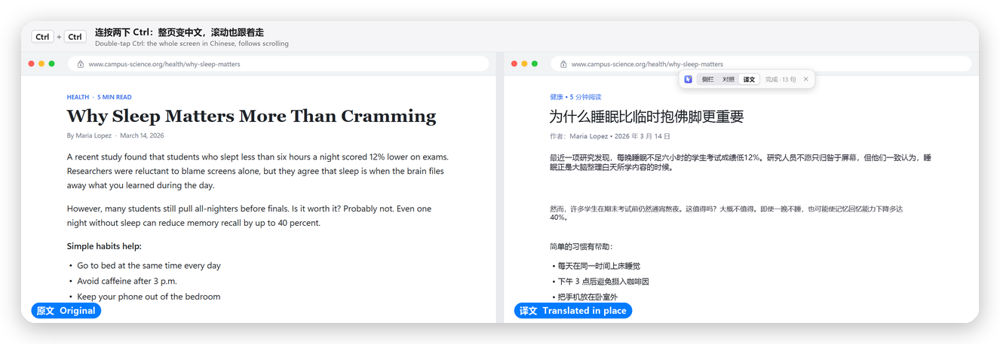
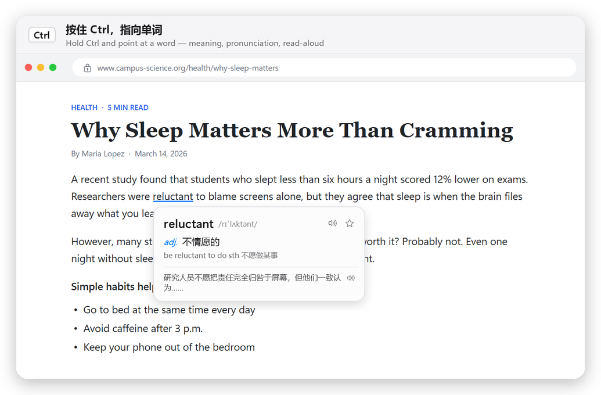
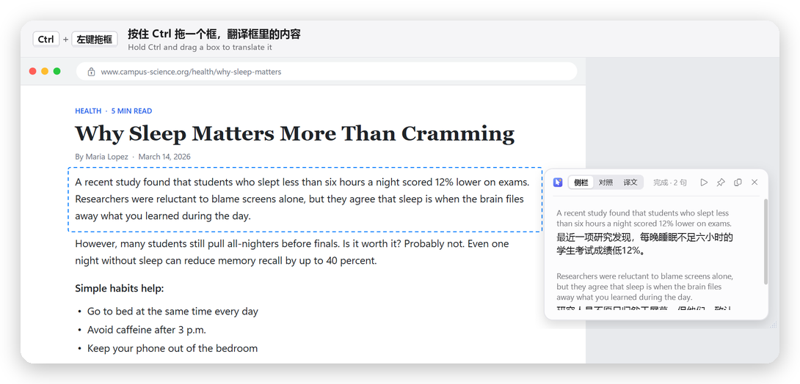
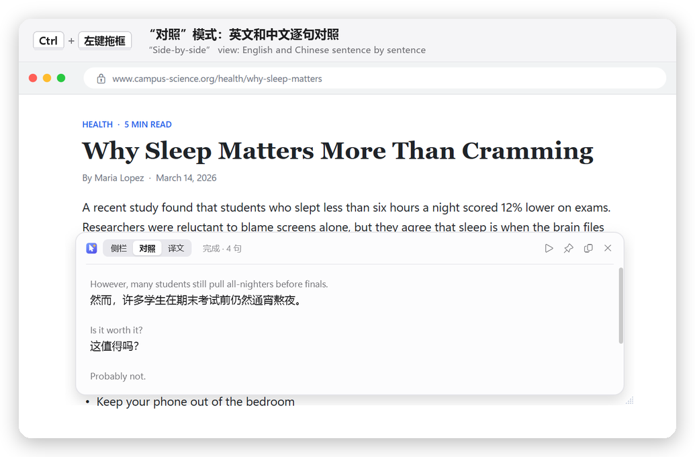
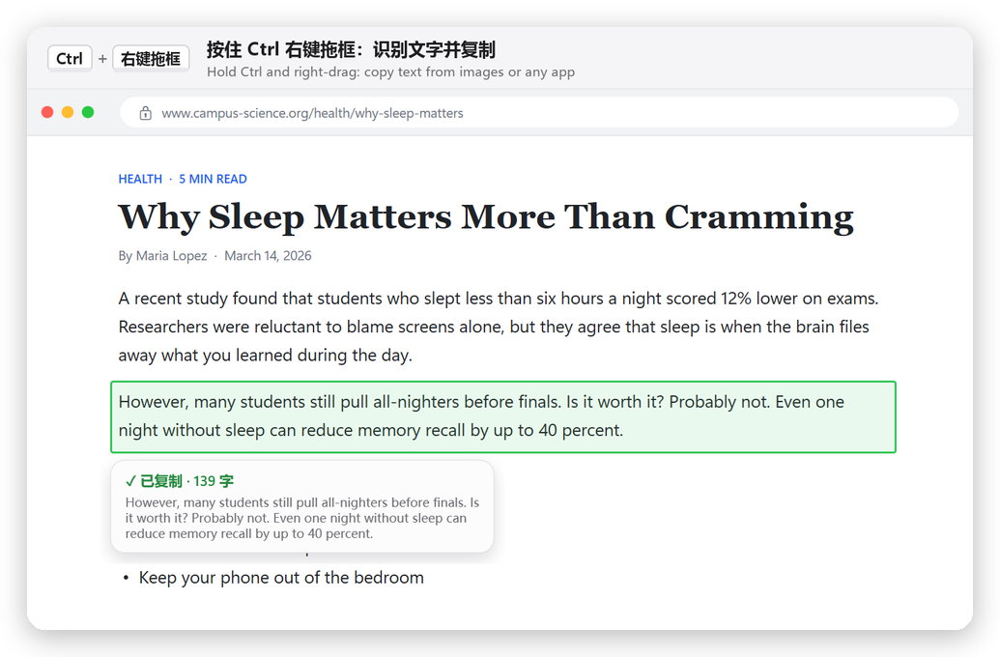

<p align="center"></p>

<h1 align="center">AI翻译鼠标 · AI Mouse</h1>

<p align="center">
让鼠标变成英译中翻译器 —— 在 Windows 上的任何软件、网页、PDF、图片里都能用。<br>
Turn your mouse into an English → Chinese translator that works on top of every Windows app.
</p>

<p align="center">
<a href="https://github.com/ryanlovec/ai-translate-mouse/releases/latest"><b>⬇ 下载 / Download</b></a>
&nbsp;·&nbsp; <a href="#中文">中文</a> &nbsp;·&nbsp; <a href="#english">English</a>
</p>

<p align="center"></p>

## 示例 · Screenshots

**① 查单词 · Look up a word** — 按住 Ctrl 指向单词 / Hold Ctrl and point



**② 框选翻译 · Translate a box** — 按住 Ctrl 左键拖框 / Hold Ctrl and left-drag



**③ 对照模式 · Side-by-side view** — 在面板顶部切换“侧栏 / 对照 / 译文” / Switch views at the top of the panel



**④ 识别复制 · Copy any text** — 按住 Ctrl 右键拖框，图片里的字也能复制 / Hold Ctrl and right-drag, works on images too



---

<a id="中文"></a>

## 中文

### 下载使用

1. 到 [Releases](https://github.com/ryanlovec/ai-translate-mouse/releases/latest) 下载 `AIMouse-…-win-x64.zip`
2. 解压，双击 `AIMouse.exe`（不需要安装任何别的东西）
3. 第一次打开会弹出设置窗口，填入 [DeepSeek](https://platform.deepseek.com) API 密钥即可。程序在右下角托盘里运行

> Windows 可能提示“已保护你的电脑”：点 **更多信息 → 仍要运行**（软件没有付费签名，代码完全公开）。

### 怎么用

| 操作 | 效果 |
|---|---|
| 按住 **Ctrl**，指向一个单词 | 在这一行下方弹出单词卡片：音标、释义、例句，可朗读 |
| 按住 **Ctrl** + 左键拖一个框 | 翻译框里的内容（侧栏 / 对照 / 译文 三种显示方式） |
| 按住 **Ctrl** + 右键拖一个框 | 识别框里的文字（中文或英文）并复制，图片、不能复制的软件也行 |
| 连按两下 **Ctrl** | 全屏实时翻译；“译文”模式用中文直接盖住英文，滚动时译文跟着走，翻过的页面会被记住 |
| **Esc** | 关闭 / 退出 |

- 翻译：DeepSeek API，也可以接本地模型（Ollama / LM Studio / llama.cpp / Jan）
- 文字识别：Windows 自带 OCR，截图不上传
- 离线词典：ECDICT，断网也能查单词
- 朗读：Windows 自带语音
- 识别中文需要在 Windows 设置里安装“中文(简体)”语言包

### 从源码编译

需要 Windows 10/11 和 [.NET 9 SDK](https://dotnet.microsoft.com/download/dotnet/9.0)：

```bash
dotnet publish -c Release -o publish
```

离线词典数据（约 27MB）不在仓库里：从 [ECDICT](https://github.com/skywind3000/ECDICT) 下载 `ecdict.csv` 和 `lemma.en.txt`，运行
`python -I tools/build_dict.py <下载文件夹> data/ecdict.tsv`，再重新编译即可。没有词典时查词直接用 AI。

密钥只保存在本机 `%APPDATA%\AIMouse`。

---

<a id="english"></a>

## English

### Download

1. Get `AIMouse-…-win-x64.zip` from [Releases](https://github.com/ryanlovec/ai-translate-mouse/releases/latest)
2. Unzip and double-click `AIMouse.exe` — nothing else to install
3. On first launch, paste your [DeepSeek](https://platform.deepseek.com) API key. The app lives in the system tray.

> If Windows SmartScreen says "Windows protected your PC", click **More info → Run anyway** (the app isn't code-signed; all source is here).

### How to use

| Gesture | Result |
|---|---|
| Hold **Ctrl** and point at a word | A word card appears below the line: pronunciation, meaning, example, read-aloud |
| Hold **Ctrl** + left-drag a box | Translate the box (side panel / under each paragraph / replace in place) |
| Hold **Ctrl** + right-drag a box | Recognize the text in the box (Chinese or English) and copy it — works on images and apps that block copying |
| Double-tap **Ctrl** | Live full-screen translation. "Replace" mode covers the English with Chinese, follows scrolling, and remembers pages you've seen |
| **Esc** | Close / exit |

- Translation: DeepSeek API, or a local model (Ollama / LM Studio / llama.cpp / Jan)
- Text recognition: built-in Windows OCR — screenshots never leave your PC
- Offline dictionary: ECDICT, works without internet
- Read-aloud: built-in Windows voices
- Chinese recognition needs the "Chinese (Simplified)" language pack in Windows Settings

### Build from source

Requires Windows 10/11 and the [.NET 9 SDK](https://dotnet.microsoft.com/download/dotnet/9.0):

```bash
dotnet publish -c Release -o publish
```

The offline dictionary (~27 MB) isn't in the repo: download `ecdict.csv` and `lemma.en.txt` from [ECDICT](https://github.com/skywind3000/ECDICT), run
`python -I tools/build_dict.py <download_dir> data/ecdict.tsv`, then rebuild. Without it, word lookups use the AI.

Your API key is stored only on your PC in `%APPDATA%\AIMouse`.

### Project layout

```
Input/      global keyboard & mouse hooks (Ctrl gestures)
Capture/    screen capture, scroll tracking, color sampling
Ocr/        Windows OCR, copy-text cleanup
Text/       sentence & paragraph splitting
Translate/  DeepSeek / local models, offline dictionary
Core/       controller, translation sessions, config, speech
UI/         word card, panel, settings, replace overlay
```

Design notes: [DESIGN.md](DESIGN.md)

---

## License · 许可证

[MIT](LICENSE). Offline dictionary data from [ECDICT](https://github.com/skywind3000/ECDICT) (MIT).
离线词典数据来自 ECDICT（MIT 许可）。
